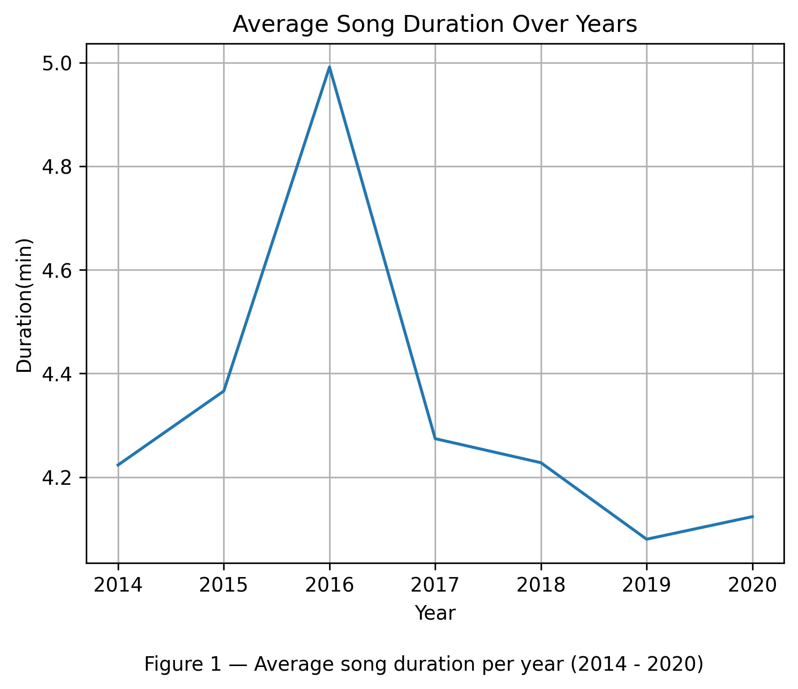
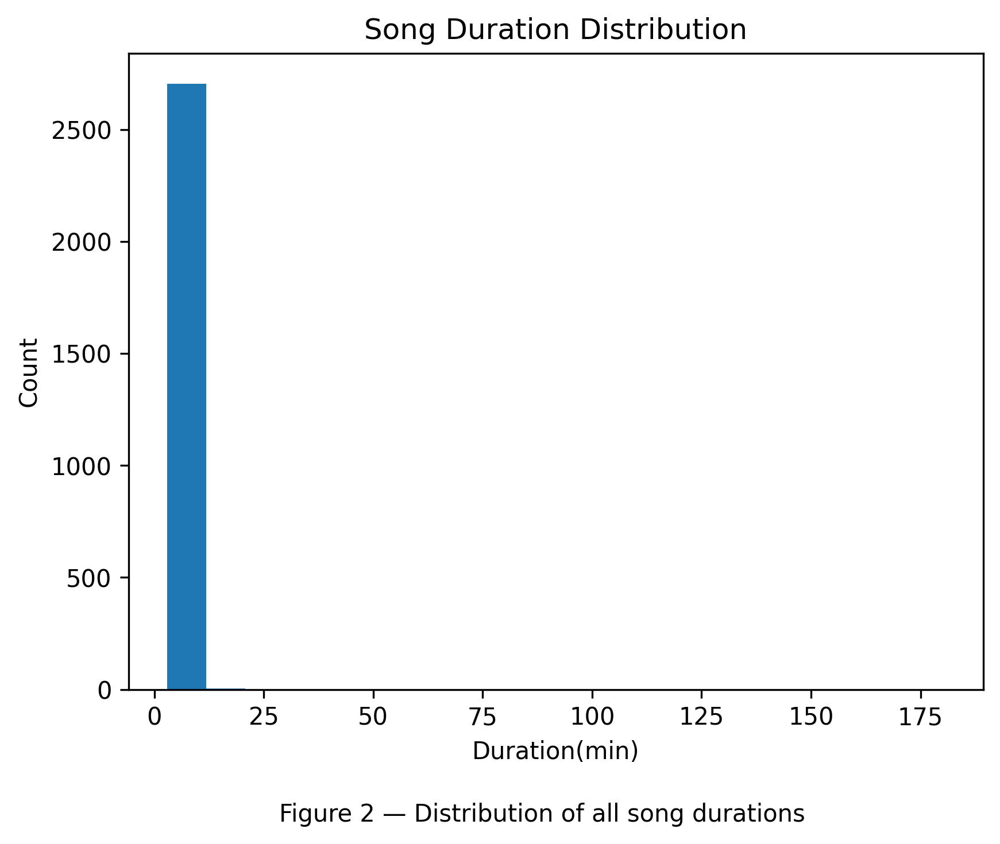
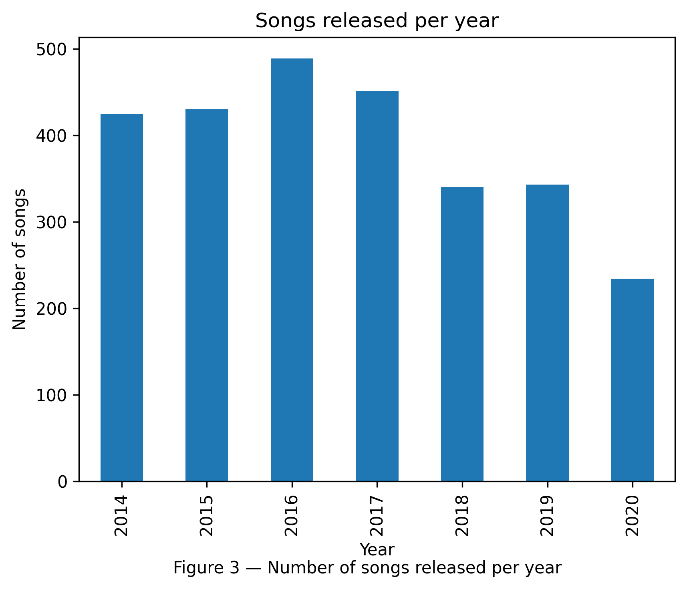
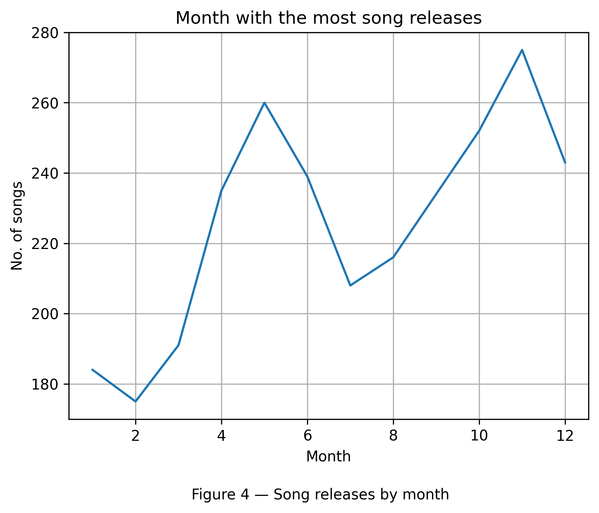
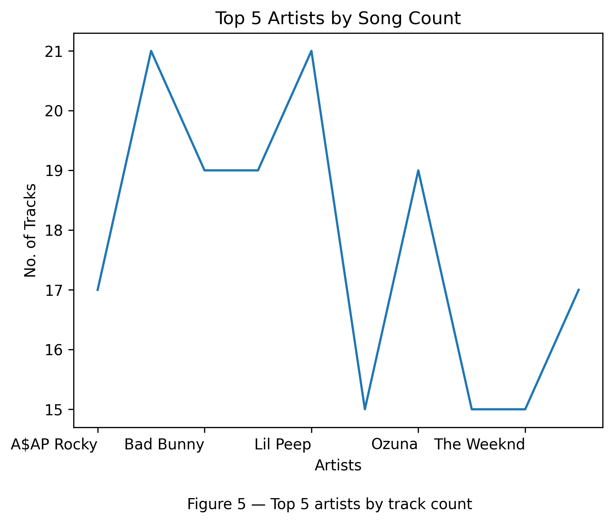
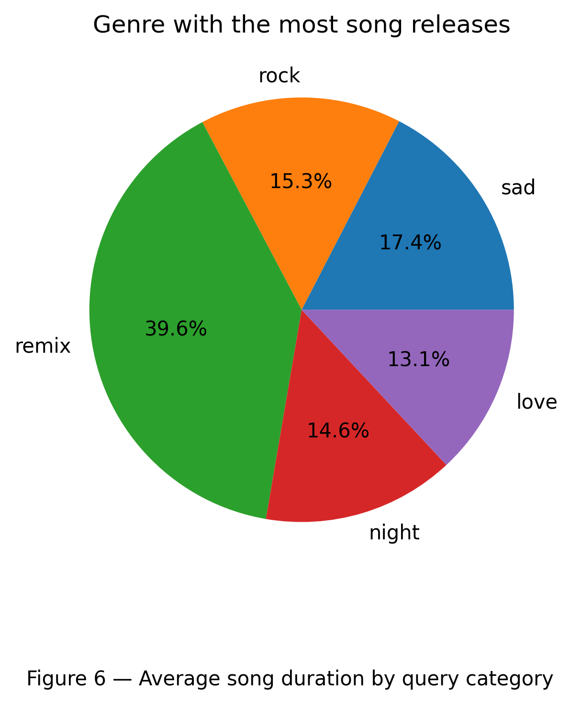

# Spotify Track Analysis (Exploratory Data Analysis Report)

## 1. Project Overview
This report presents an exploratory data analysis of a Spotify dataset spanning six years (2014–2020). The dataset was collected by querying Spotify for tracks related to five mood/genre categories: love, night, remix, rock, and sad. The analysis covers track duration trends, release patterns, artist activity, collaboration rates, and query-level comparisons.

**Tools used:** Python, Pandas, NumPy, Matplotlib

### Dataset at a Glance

| Metric                 | Value                          |
|------------------------|--------------------------------|
| Total Unique Tracks    | 1,571                          |
| Total Unique Artists   | 1,467                          |
| Year Range             | 2014 – 2020                    |
| Query Categories       | love, night, remix, rock, sad  |
| Average Duration       | 4.37 minutes                   |
| Collaboration Rate     | 33.41%                         |
| Busiest Release Month  | November                       |
| Longest Avg Category   | Sad (4.67 min)                 |
| Shortest Avg Category  | Love (3.86 min)                |

## 2. Song Duration Analysis
Song duration is one of the most fundamental audio features. The charts below show how average duration has changed over the years and how individual track lengths are distributed across the dataset.

**Key Findings:**
- Average duration fluctuates between ~3.8 and ~4.8 minutes across the period.
- A noticeable spike in average duration is visible around 2016–2017, possibly driven by the dominance of longer hip-hop and rock tracks in those years.
- Duration trends slightly downward toward 2020, consistent with the industry-wide shift toward shorter streaming-optimised songs

**Key Findings:**
- The distribution is right-skewed: most songs cluster between 3 and 5 minutes.
- A small number of outliers extend beyond 10 minutes — likely live recordings or extended remixes.
- The median (3.83 min) sits below the mean (4.37 min), confirming the right skew caused by those long-tail tracks.

## 3. Release Patterns

**Key Findings:**
- 2016 and 2017 show the highest volume of releases in the dataset.
- Output dips in 2018–2019 before partially recovering in 2020.
- The distribution across years is relatively balanced, suggesting the dataset was sampled proportionally.

**Key Findings:**
- November is the busiest release month (275 tracks), likely driven by year-end album releases ahead of the holiday season.
- April, May, and October are also strong months for new music.
- February has the fewest releases — consistent with a post-holiday lull in the music industry.

## 4. Artist Analysis

**Key Findings:**
- Anuel AA and Lil Peep jointly lead with 21 tracks each, reflecting their prolific output and cross-genre appeal during this period.
- Latin artists (Anuel AA, Farruko, Ozuna, Bad Bunny) make up 4 of the top 5, highlighting the massive rise of reggaeton and Latin trap in 2016–2020.
- With 1,467 unique artists across 1,571 tracks, the dataset is highly diverse — no single artist dominates.
- Collaboration rate: 33.41% of unique songs feature more than one artist, showing that features and joint releases are a significant part of modern music

## 5. Query Category Analysis
The dataset was built by searching Spotify with five query terms. These act as loose mood/genre labels and allow comparison across different listening contexts.

| Query | Avg Duration (min) | Track Count | Observation                                      |
|-------|--------------------|-------------|--------------------------------------------------|
| sad   | 4.67               | 472         | Longest — emotional depth, slower pace           |
| remix | 4.62               | 1,073       | Long — extended versions inflate average         |
| rock  | 4.02               | 416         | Mid — classic rock structure                     |
| night | 4.13               | 397         | Mid — electronic/ambient influence               |
| love  | 3.86               | 354         | Shortest — pop-oriented, radio-friendly          |

**Note on Remix category:**
The "remix" query returns significantly more tracks (1,073) than other categories. This is partly because remixes often feature multiple artists, and the artist-explode step in data preprocessing creates additional rows per track. This inflates the remix count relative to others and should be considered when making direct comparisons.

## 6. Conclusion

**Summary of Findings**
- Song durations average 4.37 minutes and have trended slightly shorter toward 2020, reflecting streaming platform incentives.
- November is the peak release month; the dataset shows consistent output across the 2014–2020 period.
- 1 in 3 songs (33.41%) is a collaboration, underscoring how features have become central to modern music strategy.
- Latin artists dominate the top-10 leaderboard, reflecting the global rise of reggaeton and Latin trap during this period.
- "Sad" tracks are the longest on average; "love" tracks are the shortest — suggesting mood influences production style and song structure.